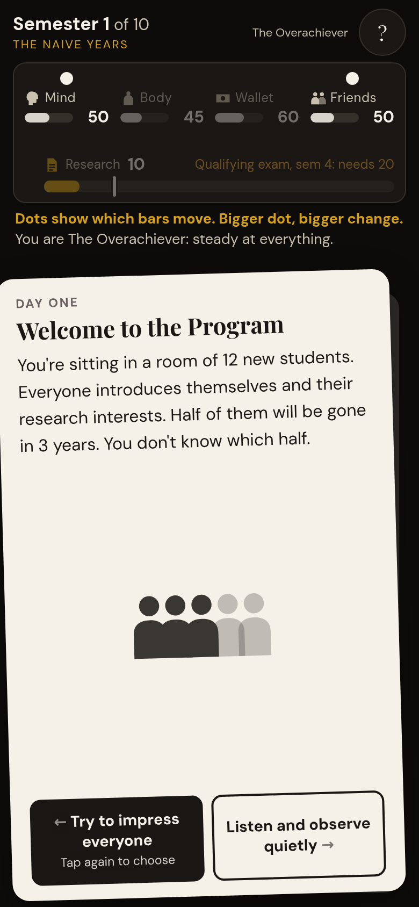
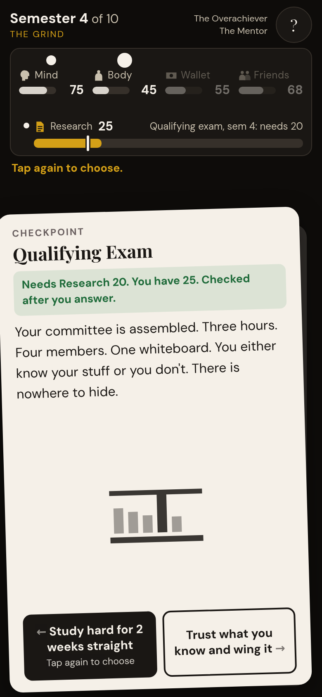

# UGA Grad Survivor

**A PhD, one difficult choice at a time.** A Reigns-inspired card game set in UGA
bioinformatics: advisor meetings, broken pipelines, stipend anxiety, Athens
life, and the long road to a defense.

[Play](https://chenhsieh.github.io/UGA-grad-survivor/) ·
[Change history](CHANGELOG.md) · [MIT license](LICENSE)

<p>


</p>

Vanilla JavaScript and CSS. No package installation, build step, or game server.

## How to play

1. Read the card. Drag it left or right to answer, or tap an answer to preview it and tap again to choose (one click with a mouse, or the arrow keys).
2. While you lean toward an answer, dots appear over the bars it will move. A bigger dot means a bigger change. The dots never say up or down; the card text does.
3. Keep **Mind, Body, Wallet and Friends** above zero. A bar at 20 or below turns red. Wallet or Friends under 20 also drain Mind and Body every card.
4. Build **Research**. The line on the Research bar is what the next checkpoint needs, and each one asks for more: qualifying exam 20 (semester 4), committee 35 (semester 6), committee 50 (semester 8), defense 65 (semester 10). Research is checked after your answer at a checkpoint, so an answer that adds Research can carry you over.
5. If a choice ends your run, you can take it back once.

The first run starts straight on a card as the Overachiever; from the second run you pick a character. After the first semester of rotations you pick an advisor. A reload keeps your run: the title offers Continue. Add `?seed=anything` to the address to replay the same card draws.

| Input | Action |
| --- | --- |
| Drag the card | Lean (dots appear), release past the edge to choose |
| Tap an answer, then tap it again | Lean, then choose |
| Mouse hover, then click | Lean, then choose |
| Left/Right arrows or A/D | Lean; press again (or Enter) to choose |
| Tab, or Up/Down arrows / W/S in selection menus | Browse archetypes or advisors |
| ? / H during play, or the help button | Help, a short word list, and themes |
| Escape | Close help |

Some answers also add career contacts, shown in the result line and on the ending screen. They never end a run but change how the ending reads.

Eight archetypes and six advisor types shape a run, with some unlocked through
play. Five archetypes and four advisors start available. Six endings are
possible: Defended, Mastered Out, Burnt Out, Hospitalized, Broke, and Disappeared.
The Mentor reduces advisor-card stat losses by **1**, boosts advisor-card Bonds
gains by **20%**, and caps Research gains at **+10 per choice**.

## Run locally

From this directory, with Python 3 installed:

```sh
python3 -m http.server 8080 --bind 127.0.0.1
```

Open <http://127.0.0.1:8080/>. Stop with Ctrl+C. Any static HTTP server can serve
the complete repository; keep `css/` and `js/` alongside `index.html`.

Use a current browser with JavaScript, localStorage, and native dialog support.
Browser zoom is enabled. Selection cards are native buttons, focus is visible,
and help contains keyboard focus. Reduced-motion preferences suppress CSS
animations. The default Institutional theme has clearer text contrast; the
other themes retain their individual palettes.

## Check a change

No automated build or package-managed test suite is shipped. A basic syntax
and whitespace check needs Node.js and Git:

```sh
for file in js/*.js js/data/*.js; do node --check "$file" || exit; done
git diff --check
```

Balance check: four bots play the real rules from the repository root.

```sh
node simulation/bots.mjs 1000 overachiever
```

With the current numbers, a bot that keeps the bars healthy but ignores Research
defends about 5% of runs (it fails the exam or the defense), a bot that chases
Research above all defends about 45% (a bar runs out), and a bot that balances
both defends about 70%. The bots see exact effects, so people seeing only dots do
worse.

Then smoke the actual browser flow:

- Begin, choose an archetype using Tab and Enter, and make both kinds of choice.
- Expand **Last result** with Enter or Space. Confirm it describes the choice
  just made, including net-zero results with offsetting effects.
- Open help, move among theme buttons with Tab, change a theme, and close with
  Escape. The run must stay unchanged while help is open.
- Check a narrow screen, rotations/advisor selection, a semester checkpoint,
  and an ending. Check keyboard focus after a choice.
- Reload mid-run and confirm the title offers Continue at the same card.

The notebooks in [simulation/](simulation/) are older balance tools for an
earlier version of the rules. None of the bots or notebooks establish human
completion rates.

## Saves, sources, and limits

- `uga_grad_survivor_v2` in localStorage stores unlocks and aggregate run
  records (schema version 3); `uga_grad_survivor_run` stores the run in
  progress so a reload can continue it; `uga_theme` stores the selected theme.
- No login, backend, analytics, or remote gameplay API is used. Some themes
  request Google Fonts; system fallbacks work if those requests are blocked.
- All card content is checked in under `js/data/`. The scenarios and resource
  model are a satirical game, not a prediction of real PhD outcomes.
- Random card draws mean a new run may differ; `?seed=` repeats them. There is
  no cross-device save or automated accessibility certification.
- Sharing is initiated by the player and copies ending text; nothing posts
  automatically. Clipboard behavior depends on browser permissions.
- The interface shows which bars an answer moves and how much, never the
  direction.

## Source map

| Path | Responsibility |
| --- | --- |
| `index.html` | Static shell and script order |
| `css/style.css` | Six themes, responsive layout, focus and motion rules |
| `js/engine.js` | Draws, effects, passive drains, checkpoints, and saves |
| `js/ui.js` | Screens, help dialog, and actual-consequence panel |
| `js/controls.js` | Buttons, menu keys, and swipe/drag controls |
| `js/data/archetypes.js` | Archetype starting stats, shared rules, and descriptions |
| `js/data/pi-data.js` | Advisor presentation |
| `js/data/cards-*.js` | Scenario and milestone pools |
| `simulation/bots.mjs` | Bot players against the current rules |
| `simulation/*.ipynb` | Historical balance notebooks |

When adding a card, use a unique ID and the existing `cL` / `cR` choices and
`eL` / `eR` effects. Preserve the perk application order and save contract;
check the actual consequence panel at stat boundaries.

Made by [Chen Hsieh](https://chenhsieh.xyz), inspired by
[Reigns](https://www.devolverdigital.com/games/reigns) by Nerial.
