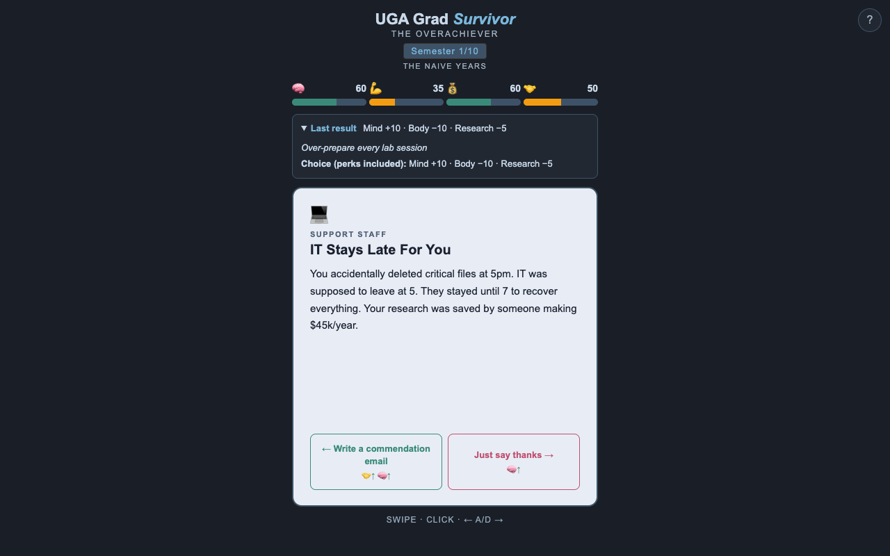

# UGA Grad Survivor

**A PhD, one difficult choice at a time.** A Reigns-inspired card game set in UGA
bioinformatics: advisor meetings, broken pipelines, stipend anxiety, Athens
life, and the long road to a defense.

[Play](https://chenhsieh.github.io/UGA-grad-survivor/) ·
[Change history](CHANGELOG.md) · [MIT license](LICENSE)



Vanilla JavaScript and CSS. No package installation, build step, or game server.

## How to play

The first run starts straight on a card as the Overachiever; the character
picker appears from the second run. After rotations you choose an advisor.
Each card offers two answers. Keep **Mind, Body, Wallet, and Friends above
zero**, keep Research above the next checkpoint mark, and reach the defense in
semester 10.

| Input | Action |
| --- | --- |
| Drag the card | Lean (dots appear), release past the edge to choose |
| Tap an answer, then tap it again | Lean, then choose |
| Mouse hover, then click | Lean, then choose |
| Left/Right arrows or A/D | Lean; press again (or Enter) to choose |
| Tab, or Up/Down arrows / W/S in selection menus | Browse archetypes or advisors |
| Enter or Space on a focused button | Activate that button |
| Enter or Space outside a control | Begin or continue at a checkpoint |
| ? / H during play, or the help button | Open help and theme settings |
| Escape | Close help |

While you lean toward an answer, a dot appears over every bar it will move,
sized by how much (small, medium, big), after your character and advisor
perks. The dots never show direction: the card text is the clue, as in Reigns.
Bars you will not touch dim. A bar at 20 or below turns red, and a dot that
could empty it pulses. After a choice the bars animate and float the change.
Research is a visible bar with the next checkpoint drawn on it, and milestone
cards say before you answer whether you will pass. If a choice ends the run you
can take it back once. A separate network value stays hidden.

Eight archetypes and six advisor types shape a run, with some unlocked through
play. Five archetypes and four advisors start available. Six endings are
possible: Defended, Mastered Out, Burnt Out, Hospitalized, Broke, and Disappeared.
The Mentor reduces advisor-card stat losses by **1**, boosts advisor-card Bonds
gains by **20%**, and caps Research gains at **+10 per choice**.

## Run locally

From this directory, with Python 3 installed:

```sh
python3 -m http.server 8080 --bind 127.0.0.1
```

Open <http://127.0.0.1:8080/>. Stop with Ctrl+C. Any static HTTP server can serve
the complete repository; keep `css/` and `js/` alongside `index.html`.

Use a current browser with JavaScript, localStorage, and native dialog support.
Browser zoom is enabled. Selection cards are native buttons, focus is visible,
and help contains keyboard focus. Reduced-motion preferences suppress CSS
animations. The default Institutional theme has clearer text contrast; the
other themes retain their individual palettes.

## Check a change

No automated build or package-managed test suite is shipped. A basic syntax
and whitespace check needs Node.js and Git:

```sh
for file in js/*.js js/data/*.js; do node --check "$file" || exit; done
git diff --check
```

Then smoke the actual browser flow:

- Begin, choose an archetype using Tab and Enter, and make both kinds of choice.
- Expand **Last result** with Enter or Space. Confirm it describes the choice
  just made, including net-zero results with offsetting effects.
- Open help, move among theme buttons with Tab, change a theme, and close with
  Escape. The run must stay unchanged while help is open.
- Check a narrow screen, rotations/advisor selection, a semester checkpoint,
  and an ending. Check keyboard focus after a choice.
- Reload to confirm unlock persistence and that a fresh title screen appears.

The notebooks in [simulation/](simulation/) are separate historical balance
tools with their own requirements. They are not needed to run the game and do
not establish current human completion rates.

## Saves, sources, and limits

- `uga_grad_survivor_v2` in localStorage stores unlocks and aggregate run
  records (schema version 3); `uga_theme` stores the selected theme.
  **The active run is not saved.** Reloading abandons it and returns to the title.
- No login, backend, analytics, or remote gameplay API is used. Some themes
  request Google Fonts; system fallbacks work if those requests are blocked.
- All card content is checked in under `js/data/`. The scenarios and resource
  model are a satirical game, not a prediction of real PhD outcomes.
- Random card draws mean a new run may differ. There is no seeded replay UI,
  cross-device save, or automated accessibility certification.
- Sharing is initiated by the player and copies ending text; nothing posts
  automatically. Clipboard behavior depends on browser permissions.
- The interface shows which bars an answer moves and how much, never the
  direction. The network value stays hidden.

## Source map

| Path | Responsibility |
| --- | --- |
| `index.html` | Static shell and script order |
| `css/style.css` | Six themes, responsive layout, focus and motion rules |
| `js/engine.js` | Draws, effects, passive drains, checkpoints, and saves |
| `js/ui.js` | Screens, help dialog, and actual-consequence panel |
| `js/controls.js` | Buttons, menu keys, and swipe/drag controls |
| `js/data/archetypes.js` | Archetype starting stats, shared rules, and descriptions |
| `js/data/pi-data.js` | Advisor presentation |
| `js/data/cards-*.js` | Scenario and milestone pools |
| `simulation/` | Historical balance notebooks |

When adding a card, use a unique ID and the existing `cL` / `cR` choices and
`eL` / `eR` effects. Preserve the perk application order and save contract;
check the actual consequence panel at stat boundaries.

Made by [Chen Hsieh](https://chenhsieh.xyz), inspired by
[Reigns](https://www.devolverdigital.com/games/reigns) by Nerial.
